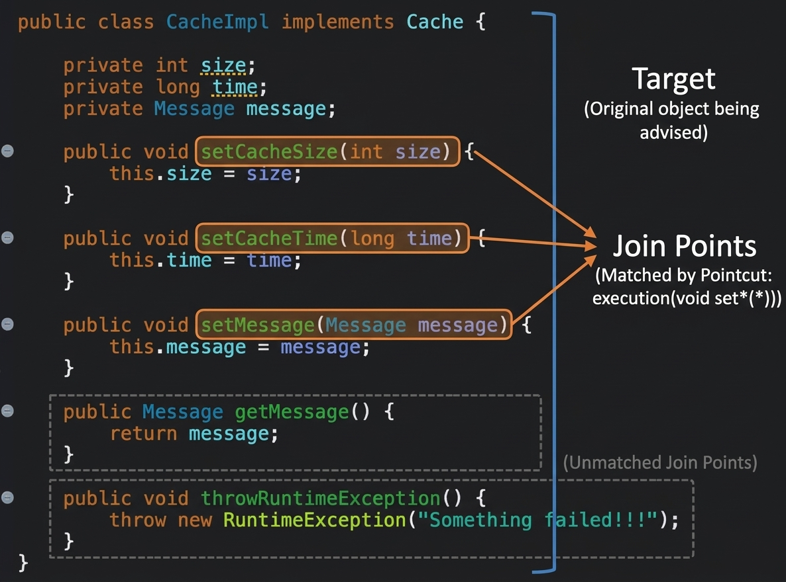
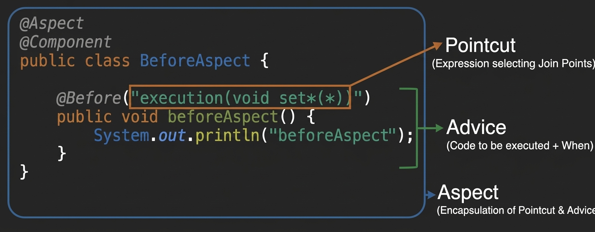
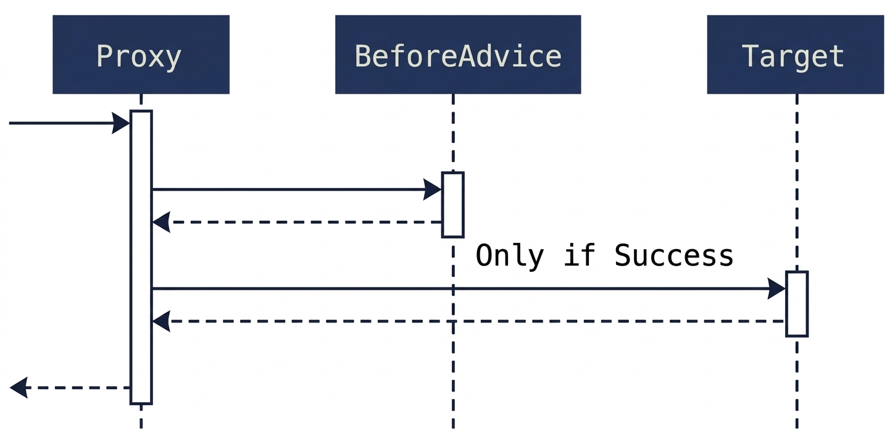
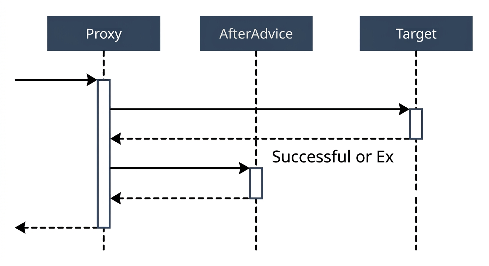
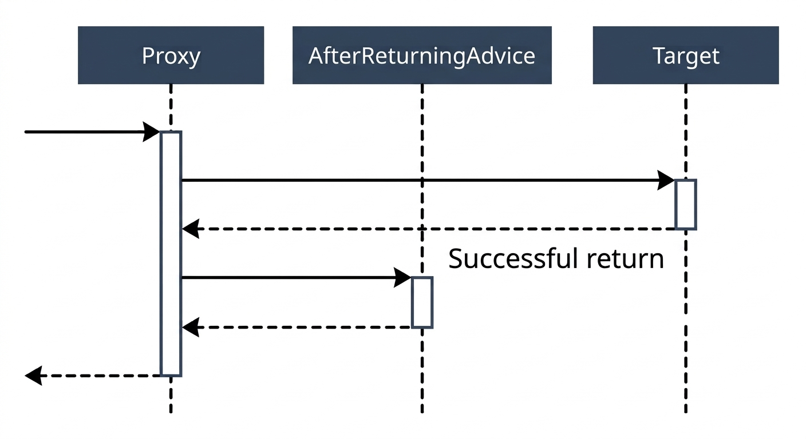
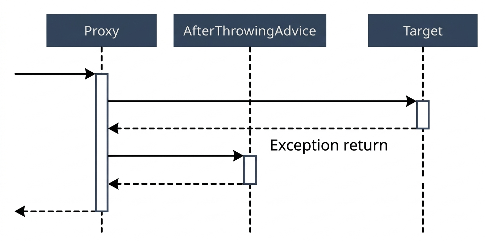
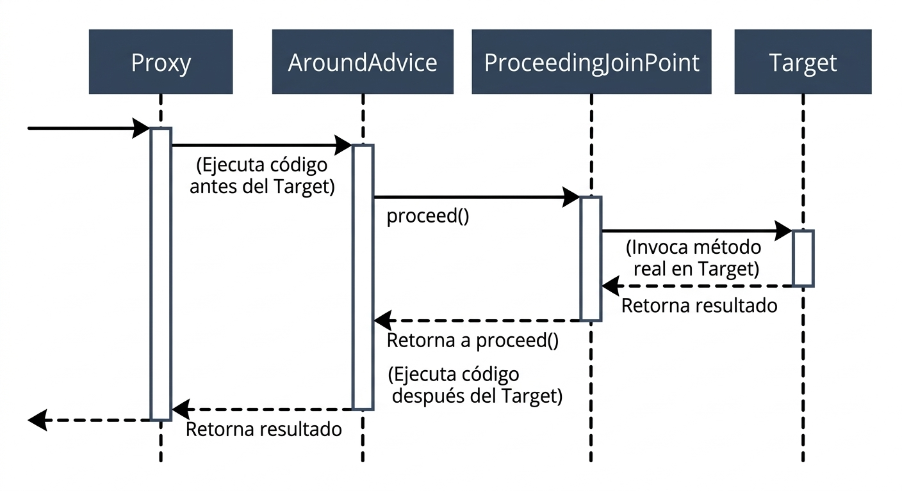

# 🛠 🚀 Spring Certification 🚀 🛠 
Exercises for Spring Certified Professional

## ✅ Spring AOP ✅
Here is an example of applying AOP.

### Core Concepts

##### Join Point
A point in the execution of a program like a method call or exception thrown.

<p>
    
</p>

##### Pointcut
The expression that selects the Join Point.

For selecting where to apply the advice.

##### Advice
The code to be executed.

##### Aspect
The encapsulation of the Pointcut & Advice. The What and the Where.

##### Weaving
The technique where the aspect and the target are merged.

<p>
    
</p>

##### Proxy
When someone stands in place of someone else.

##### Spring Proxy
When an enhanced class stands in place of your original.


#### Before Advice

The Target will only be executed if the Advice returns successfully with no exceptions.

<p>
    
</p>

```log
1. Spring creates a Proxy, weaving Aspect & Target.

2. Proxy implements Target interface if JDK Proxy is used. 
   Proxy extends Target if CGLIB Proxy is used.

3. All calls are routed to Proxy interceptor.

4. Matching Advice is executed.

5. If there are no exceptions thrown, Target method is executed.
```

#### After Advice

The Advice will only be executed if the Target returns successfully or exception.

<p>
    
</p>

```log
1. Spring creates a Proxy, weaving Aspect & Target.

2. Proxy implements Target interface if JDK Proxy is used. 
   Proxy extends Target if CGLIB Proxy is used.

3. All calls are routed to Proxy interceptor, which invokes the Target method first.

4. Matching Advice is executed after the Target method finishes (no matter if there was an Exception or a Successful return).

5. Proxy returns the result (or rethrows the exception) back to the caller.
```

#### After Returning Advice

The Advice will only be executed if the Target returns successfully with no exceptions.

<p>
    
</p>

```log
1. Spring creates a Proxy, weaving Aspect & Target.

2. Proxy implements Target interface if JDK Proxy is used. 
   Proxy extends Target if CGLIB Proxy is used.

3. All calls are routed to Proxy interceptor, which invokes the Target method first.

4. If no Exception is thrown, matching Advice is executed.

5. Control returns to Proxy (and the result is returned to the caller).
```

#### After Throwing Advice

The Advice will only be executed if the Target returns exceptions.

<p>
    
</p>

```log
1. Spring creates a Proxy, weaving Aspect & Target.

2. Proxy implements Target interface if JDK Proxy is used. 
   Proxy extends Target if CGLIB Proxy is used.

3. All calls are routed to Proxy interceptor, which invokes the Target method first.

4. If an Exception is thrown, matching Advice is executed.

5. Control returns to Proxy (and the exception is propagated to the caller).
```

#### Around Advice

Use the Around Advice to execute things before or after the Target.

<p>
    
</p>

```log
1. Spring creates a Proxy, weaving Aspect & Target.

2. Proxy implements Target interface if JDK Proxy is used. 
   Proxy extends Target if CGLIB Proxy is used.

3. All calls are routed to Proxy interceptor, which invokes the matching AroundAdvice first.

4. AroundAdvice executes code before, calls ProceedingJoinPoint.proceed() to invoke the Target method, and then executes code after it returns.

5. Control and the final result return to Proxy (and are sent back to the caller).
```

